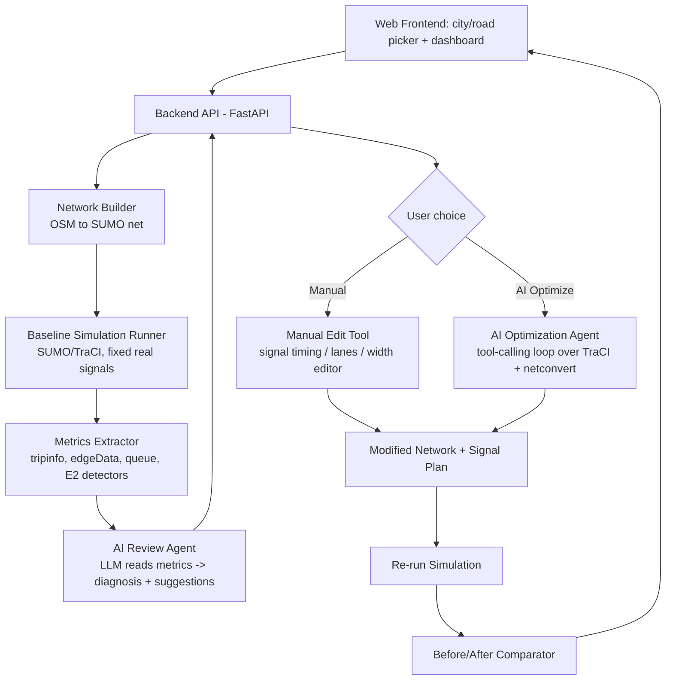

# AI-Assisted Traffic & Road Infrastructure Sandbox — Project Plan

**Goal:** A sandbox where a real city road/intersection is simulated with realistic traffic (fixed real-world signal timings as the baseline), an AI reviews the simulation output and proposes fixes, and the user can either edit the intersection manually or let the AI redesign it (signals, road width, footpaths, dustbins) signal-by-signal — with a clear before/after comparison at the end.

This document is written to be actionable by both a human developer and a coding AI agent (e.g. Claude Code). It intentionally excludes RL-agent *training* — the "AI" here is an LLM reasoning/tool-calling agent that reads simulation metrics and either recommends or directly applies changes, then re-simulates to prove the improvement.

---

## 1. Problem Statement

Cities like Bangalore fix traffic problems by physical trial-and-error (change a signal timer, wait weeks, measure, repeat). This is slow, expensive, and politically risky. This project replaces that loop with a **digital twin sandbox**: import a real road/intersection, simulate it accurately, let an AI diagnose problems from the data, and let it (or the user) test infrastructure changes virtually before anything is touched in the real world.

## 2. Core User Flow (as specified)

This is the exact pipeline the app must implement — treat it as the spec:

1. **Select a city + a specific road/intersection.**
2. **Run a baseline simulation** in SUMO/CityFlow using the *real, fixed* (as-is) signal timings and real road geometry.
3. **Show the user the raw simulation results** (queue lengths, wait times, throughput, congestion hot-spots, etc.).
4. **Send that data to an AI** which reviews it and returns a written assessment + suggested changes (no changes applied yet — this is a "diagnosis" step).
5. **User picks a mode:**
   - **Manual mode** — user edits signal timing / lanes / etc. themselves.
   - **AI mode** — AI goes signal-by-signal (and infrastructure-element-by-element: road width, footpath, dustbin placement) and applies what it judges to be the optimal change, wherever it detects a problem.
6. **Re-run the simulation** with the new configuration.
7. **Show a Before vs. After comparison** (metrics side-by-side, and ideally visual playback side-by-side).

Everything below is organized around building exactly these 7 steps.

---

## 3. High-Level Architecture



**Three simulation layers, kept separate on purpose:**
- **Dynamic layer** (SUMO/TraCI): vehicles, signal phases/timings, queues, speeds — this is what actually gets *simulated*.
- **Static network layer** (SUMO `.net.xml` via `netconvert`/`netedit`, or `sumolib`): lane count, road width, sidewalks/footpaths — edited *between* simulation runs, not live.
- **Annotation layer** (custom, not a native SUMO concept): dustbin placement, and any other urban-furniture suggestion — rendered as POIs on the map, driven by heuristics + LLM reasoning over pedestrian/vehicle density, not something SUMO simulates physically. Be explicit with the user that this layer is a *recommendation overlay*, not a physically-modeled effect.

---

## 4. Recommended Tech Stack

| Layer | Choice | Why |
|---|---|---|
| Traffic simulator | **SUMO** (Eclipse SUMO) primary; CityFlow optional for large-scale speed | SUMO natively supports real OSM road geometry, pedestrians, sidewalks, and per-junction signal programs — all things you need. CityFlow is 20x faster but has weaker geometry/pedestrian fidelity, so it's a poor fit for "road width/footpath" edits. **Recommendation: build on SUMO.** |
| Simulation control | **TraCI** (Python) or **libsumo** (same API, in-process, much faster, no sockets) | Both let you read live metrics and change signal phases programmatically. |
| Road network import | `osmWebWizard.py` / `netconvert` (ships with SUMO) | Pulls real OSM data for any city/road and converts to SUMO's `.net.xml`. |
| Network editing (width, lanes, sidewalks) | `netedit` (GUI, for manual mode) + `sumolib`/`netconvert` (scriptable, for AI mode) | `netedit` is SUMO's official GUI network editor — good reference for what a "manual edit" UI needs to expose. |
| Backend | **Python + FastAPI** | SUMO's tooling is Python-first (`sumolib`, `traci`); FastAPI gives you async endpoints + easy long-running-job handling for simulation runs. |
| AI layer | **Claude (or GPT-4) via tool-calling**, *not* a trained RL policy | Per your instruction to skip agent training — the AI acts as a reasoning agent that calls tools (read metrics, propose signal plan, edit network, re-simulate), similar to the "LLM + tool" pattern below. |
| Frontend | **React + a map library (MapLibre GL / Leaflet)** for road selection, plus a charts library (Recharts/Plotly) for before/after metrics | Matches your "city and road selection" + "show data" requirements. |
| Live/replay visualization | Convert SUMO's FCD/trip output to GeoJSON and animate on the map, OR embed a Three.js-based player | See `sumo-web3d` reference below — it already does TraCI→browser 3D playback. |
| Job orchestration | Simple job queue (Celery/RQ or even a background asyncio task) since a SUMO run + AI review can take seconds-to-minutes | Keeps the API responsive while a sim runs. |

---

## 5. Existing Projects to Borrow Code From

Don't build any of this from scratch — every piece below has a working open-source reference.

| # | Project | Repo | What to borrow |
|---|---|---|---|
| 1 | **Eclipse SUMO** | `eclipse-sumo/sumo` (github.com/eclipse-sumo/sumo) | The simulator itself, `netconvert`, `netedit`, `osmWebWizard.py`, `sumolib`, `traci` — this is your foundation, not optional. |
| 2 | **CityFlow** | `cityflow-project/CityFlow` | Reference only, if you later want a faster city-scale engine; its Python API design is a good model for a clean simulation interface. |
| 3 | **SUMO-RL** | `LucasAlegre/sumo-rl` | Even though you're skipping RL training, its `TrafficSignal` class (github.com/LucasAlegre/sumo-rl → `sumo_rl/environment/traffic_signal.py`) is the cleanest existing example of reading phase state, queue length, and waiting time via TraCI — copy this pattern for your metrics extractor. |
| 4 | **LibSignal** | `DaRL-LibSignal/LibSignal` | Cross-simulator (SUMO + CityFlow) abstraction layer and a SUMO↔CityFlow network converter (`converter.py`) — useful if you ever want to swap engines without rewriting the app. |
| 5 | **Deep-QLearning-Agent-for-Traffic-Signal-Control** | `AndreaVidali/Deep-QLearning-Agent-for-Traffic-Signal-Control` | Good minimal example of a single fixed SUMO intersection scenario + config structure (`.sumocfg`, route generation) — a fast way to get your first end-to-end pipeline running before you plug in a real city. |
| 6 | **LemgoRL** | `RL-INA/LemgoRL` | Real-world intersection modeled in SUMO with realistic demand — good reference for how to structure a *realistic single-intersection* scenario (their process diagram matches your baseline-simulation step closely). |
| 7 | **LLMLight / LLMTSCS** | `usail-hkust/LLMTSCS` | An LLM used as the traffic-signal decision agent, with prompt templates for feeding traffic state to the LLM and parsing its decision — directly reusable for your "AI review" step's prompt design. |
| 8 | **iLLM-TSC** | `Traffic-Alpha/iLLM-TSC` | LLM reviews a signal-control decision and returns a natural-language explanation + a corrected action (e.g., prioritizing an ambulance) — this is essentially your Step 4 ("AI reviews the data and gives review + suggested changes") already implemented once. |
| 9 | **LLM-Assisted Light** | `Traffic-Alpha/LLM-Assisted-Light` | Declares scenario "events" (accidents, emergency vehicles) in YAML and has the LLM produce an "execution feedback" with justification — good template for your AI's before/after explanation text. |
| 10 | **SUMO-MCP** | `ycycycl/SUMO-MCP` (code to be released per the paper) | Wraps SUMO's whole workflow — OSM import, demand generation, running batches with different signal strategies, comparative analysis/reporting — behind natural-language/tool-calling commands via MCP. This is architecturally the closest existing project to your *entire* app; study its tool list even if you don't use MCP directly. |
| 11 | **sumo-web3d** | `sidewalklabs/sumo-web3d` | Live web-based 3D visualization of a running SUMO sim using TraCI + three.js, with a scenario dropdown and playback controls — reuse this almost directly for your "show simulation data/visuals to user" step. |
| 12 | **sumo-dashboard** | `sppub/sumo-dashboard` | Streamlit dashboard that converts SUMO's XML outputs (tripinfo, edge data, O/D matrices) into pandas DataFrames and charts — copy its parsing utilities for your metrics/KPI dashboard even if you rebuild the UI in React. |

**Suggested build order using these:** start from #5 (single fixed intersection) → swap in real OSM data using #1's `osmWebWizard` → adopt #3's metrics-reading pattern → add #11/#12-style visualization → add the LLM review step modeled on #7/#8/#9 → structure the whole pipeline the way #10 does.

---

## 6. Module Breakdown

### 6.1 City & Road Selection + Network Import
- **Input:** user picks a city (start with Bangalore) and draws/selects a bounding box or picks a named road/junction on a map (Leaflet/MapLibre).
- **Process:** call SUMO's `osmWebWizard.py` logic (or replicate it: fetch OSM extract for the bbox from the Overpass API → run `netconvert --osm-files area.osm.xml -o area.net.xml`).
- Use typemaps that matter for this project: `osmNetconvertPedestrians.typ.xml` (adds sidewalks — needed later for the footpath module) and default vehicle typemap.
- Useful `netconvert` flags: `--tls.guess-signals --tls.discard-simple --tls.join` (clean up traffic light detection), `--sidewalks.guess`, `--crossings.guess` (pedestrian infrastructure).
- **Output:** `city.net.xml` (road network) + the original traffic-light program extracted as-is (this becomes your "real, fixed" baseline signal plan — SUMO auto-generates a default program if OSM doesn't specify timings, so flag this to the user: true real-world **signal timings** for Indian intersections are rarely in OSM and may need to be entered manually or estimated from **Webster's formula** as a stand-in "current real-world" baseline).
- **Demand (traffic) generation:** since OSM has no traffic counts, generate route/demand files with SUMO's `randomTrips.py`, or better, calibrate flow volumes against any available real counts (Bangalore Traffic Police / OpenCity data, see §12).

### 6.2 Baseline Simulation (Fixed Real-World Signals)
- Run headless via `libsumo` (faster, single process) for the length of a representative period (e.g., a 1-hour morning-peak window).
- Signal program must be **static/fixed** for this run — this is deliberately *not* SUMO's actuated/adaptive control, since the point is to reproduce today's real, unoptimized behavior.
- Log outputs: `--tripinfo-output`, `--summary-output`, `--queue-output`, and place **E2 lane-area detectors** at each approach to each signal (this gives per-approach queue length and occupancy, which the AI needs to reason "signal-by-signal").

### 6.3 Metrics Extraction & Dashboard (Step 3 in the flow)
Parse the XML outputs (borrow `sumo-dashboard`'s parsing utilities) into a clean JSON/DataFrame with, at minimum:
- Average & max wait time per approach/lane
- Average queue length per approach
- Throughput (vehicles cleared per signal cycle)
- Average travel time / delay vs. free-flow time
- Number of stops per vehicle
- Pedestrian wait time at crossings (if pedestrians are modeled)
- Emissions/fuel waste from idling (SUMO has a built-in HBEFA emissions model — nice qualitative selling point for a "traffic problem" pitch)

Render this as charts + a heatmap of the road network colored by congestion (this is your "show the data out of the simulation to the user" step).

### 6.4 AI Review Layer (Step 4 — diagnosis only, no changes applied)
- Send the structured metrics JSON (not raw XML) to the LLM with a prompt template modeled on LLMLight/iLLM-TSC's state-description prompts.
- Ask for: (a) a plain-language review of what's wrong and where, (b) a ranked list of suggested changes (signal retiming, lane reallocation, road widening, added footpath/crossing, dustbin relocation) with the *reasoning* for each, (c) an estimated-impact statement per suggestion.
- Return this as structured JSON (use a strict schema / forced tool-call output) so the frontend can render it as cards, one per suggestion, each tagged to a specific junction/edge on the map.
- **Nothing is applied to the simulation yet** — this is purely advisory, matching your spec.

### 6.5 Mode Selector (Step 5)
Two branches from here — build both against the *same* underlying "apply a change → re-simulate" function so Manual and AI mode share code.

### 6.6 Manual Editing Tool
- Minimum viable editor: a form/panel per selected junction letting the user change phase durations, and per selected edge letting the user change lane count/width and toggle a sidewalk.
- Under the hood this is just calling `sumolib.net` read/modify/write, or (simpler for MVP) shelling out to `netconvert` with edited plain-XML (`.edg.xml`, `.tll.xml`) description files.
- If you want a fast MVP, literally embed/launch **`netedit`** (SUMO's own network editor) for this instead of building a custom one, and only build the custom UI once the AI-mode pipeline works.

### 6.7 AI Optimization Loop (Step 5, AI branch — "signal by signal")
This is the core novel piece. Structure it as an **agentic tool-calling loop**, following the SUMO-MCP / iLLM-TSC pattern, *not* RL training:

1. Agent receives the list of junctions/edges flagged as problems in §6.4.
2. For each one, agent calls a `get_junction_state(id)` tool → gets current phase plan, queue lengths, approach geometry.
3. Agent calls a `propose_change(id, change)` tool with a candidate edit (e.g., new green-time split, or "add a right-turn lane", or "add sidewalk on edge X").
4. Backend applies the change to a **scratch copy** of the network/signal plan, re-runs a fast simulation slice for just that junction's demand, and returns the resulting metrics to the agent.
5. Agent compares before/after for that junction; if improved, keep it and move to the next junction; if not, either try another candidate (bounded retries) or leave it flagged as "no safe improvement found."
6. Signal-timing candidates can be seeded with **Webster's formula** or **max-pressure control** (a well-established, non-ML heuristic used across the TSC literature — see LibSignal's baselines) so the LLM isn't guessing timings from scratch; its job is to choose/adjust among sensible candidates and justify the pick, and to reason about interactions between neighboring junctions.
7. Road-width / lane-count / footpath changes are network edits (via `sumolib`) applied the same way — propose, apply to scratch copy, re-simulate, keep-or-discard.
8. **Dustbin placement** has no traffic-flow effect to simulate, so treat it separately: a rule-based/LLM-reasoned placement (e.g., near bus stops, junctions with high pedestrian counts, away from vehicle path) written out as `<poi>` entries in a SUMO additional file purely for map display — be upfront with the user that this suggestion is not simulation-validated, unlike the traffic changes.
9. Log every accepted change with the AI's stated reasoning — this becomes the "review" text shown alongside the before/after.

### 6.8 Before/After Comparison (Step 7)
- Run the full baseline scenario and the full optimized scenario back to back, using **identical demand (routes)** for a fair comparison.
- Side-by-side: KPI table (§6.3 metrics, baseline vs. optimized, % change), congestion heatmap before vs. after, and (using the `sumo-web3d`-style player) a synchronized side-by-side playback if you have time for it.
- Include the AI's accumulated reasoning log from §6.7 step 9 as a human-readable changelog under the comparison.

---

## 7. Key File Formats You'll Touch (SUMO)

| File | Purpose |
|---|---|
| `*.net.xml` | The road network (edges, lanes, junctions, traffic-light logic) — this is what road-width/lane/footpath edits change. |
| `*.rou.xml` | Vehicle routes/demand. |
| `*.sumocfg` | Ties network + routes + outputs together for a run. |
| `*.add.xml` | "Additional" file for detectors (E2 lane-area detectors), and POIs (dustbin markers). |
| `tripinfo-output`, `summary-output`, `queue-output` (XML) | Simulation results you parse for metrics. |
| `*.tll.xml` | Traffic light logic (signal phases/timings) as plain XML — useful for scripted edits without touching the whole net file. |

---

## 8. Suggested Repo Structure

```
traffic-sandbox/
├── backend/
│   ├── api/                # FastAPI routes: /import, /simulate, /review, /optimize, /compare
│   ├── sim/
│   │   ├── network_import.py   # osmWebWizard/netconvert wrapper
│   │   ├── runner.py            # libsumo/traci simulation runner
│   │   ├── metrics.py           # XML output -> structured JSON (borrow sumo-dashboard parsing)
│   │   └── editor.py            # sumolib-based programmatic network/signal edits
│   ├── ai/
│   │   ├── review_agent.py      # Step 4 diagnosis prompt + schema
│   │   └── optimize_agent.py    # Step 5/6.7 tool-calling loop
│   └── jobs/                # background job runner for long simulations
├── frontend/
│   ├── components/MapPicker/
│   ├── components/MetricsDashboard/
│   ├── components/AIReviewPanel/
│   ├── components/ManualEditor/
│   └── components/BeforeAfterView/
├── scenarios/                # per-city/road scratch data: net files, routes, outputs
└── reference-repos/          # cloned copies of the projects in §5, for code reuse
```

---

## 9. Build Phases (Roadmap)

| Phase | Deliverable | Reference to lean on |
|---|---|---|
| 0 | SUMO installed, one hand-built single-intersection scenario running headless with fixed timings | `Deep-QLearning-Agent-for-Traffic-Signal-Control` scenario structure |
| 1 | Real road imported from OSM for a chosen Bangalore junction; baseline sim runs on real geometry | `osmWebWizard.py`, `netconvert` |
| 2 | Metrics extraction + web dashboard showing baseline KPIs | `sumo-dashboard` parsing, `sumo-rl`'s `TrafficSignal` metric reads |
| 3 | AI review step: metrics → LLM → structured diagnosis shown in UI | `LLMTSCS`, `iLLM-TSC` prompt patterns |
| 4 | Manual edit mode: change signal timing/lane count by hand, re-simulate, see new KPIs | `netedit` as reference/fallback |
| 5 | AI optimization loop: signal-by-signal propose→simulate→keep loop for timing only | `SUMO-MCP`-style tool-calling architecture, max-pressure/Webster baselines |
| 6 | Extend AI loop to road width & footpath (network edits) + dustbin POI layer | `sumolib` net editing |
| 7 | Before/after comparison view (KPI diff + heatmap + optional synchronized playback) | `sumo-web3d` |
| 8 | Polish: multi-junction corridors, saved scenarios, city-scale (swap in CityFlow if needed for speed) | `LibSignal`, `CityFlow` |

Build phases 0–3 first as a thin vertical slice (one intersection, end-to-end) before going wide — this proves the whole loop works before you invest in the editor UI or multi-junction scale.

---

## 10. Algorithms/Heuristics Worth Knowing (non-ML, deterministic — good AI-agent tool primitives)

- **Webster's formula** — classic method to compute a theoretically optimal fixed-cycle signal timing from approach flow rates; good seed/candidate generator for the AI to adjust rather than inventing timings from scratch.
- **Max-pressure control** — a simple, well-studied decentralized signal-control rule (used as a baseline across LibSignal, sumo-rl, etc.) that sets the green phase to whichever approach has the highest "pressure" (queue imbalance); good deterministic fallback/baseline to compare the AI's picks against.
- **SOTL (Self-Organizing Traffic Lights)** — another simple deterministic baseline, useful for sanity-checking the AI isn't doing worse than a trivial rule.

## 11. Notes on the Infrastructure-Suggestion Layer (Road Width / Footpath / Dustbin)

Be realistic with scope here, since these aren't things SUMO natively "optimizes":
- **Road width / lane count**: directly simulatable — changing lane count or width in `.net.xml` and re-running genuinely changes throughput/queueing, so treat this like a signal change (propose → simulate → keep/discard).
- **Footpaths/crossings**: SUMO does simulate pedestrians and sidewalks if you model them (person flows + `--pedestrian` options), so this *can* be validated in-sim if you invest in adding pedestrian demand — otherwise treat it as a geometry recommendation only.
- **Dustbin placement**: not a traffic-simulation concept at all. Implement as a separate rule-based/LLM-reasoned recommendation layer (heuristics: near transit stops, high foot-traffic junctions, set back from vehicle path) rendered as map markers, explicitly labeled in the UI as "not simulation-validated" so users don't confuse it with the physically-tested signal/road suggestions.

## 12. Bangalore-Specific Data Sources to Look Into
- OpenStreetMap export for Bangalore (via `osmWebWizard`/Overpass) — free, immediately usable road geometry.
- Bangalore Traffic Police / BBMP / OpenCity Bangalore open-data portals — worth checking for any published junction-level traffic-volume or signal-timing data to calibrate demand/baseline signals against (availability varies; if nothing usable is found, fall back to `randomTrips.py`-generated demand calibrated by eye against known congestion hot spots).

## 13. Risks & Honest Limitations
- OSM signal-timing data is usually missing/incomplete — you'll likely need to hand-enter or estimate "real" baseline timings for your target junction(s) rather than pulling them automatically.
- Demand (how many vehicles, going where) is the hardest part to make "real-world accurate" — geometry accuracy from OSM is good, traffic-volume accuracy depends entirely on what counts data you can find or estimate.
- SUMO's left/right-hand driving and lane-discipline modeling is more European/US-oriented; Indian mixed traffic (two-wheelers weaving, lane discipline being loose) is not perfectly captured by default car-following models — flag this as a known fidelity gap rather than promising simulation will be "real-world accurate" out of the box.
- Keep the AI's infrastructure edits (road width, footpaths) sandboxed to scratch copies of the network — never let the agent loop run unbounded; always cap retries and always require the before/after to actually show improvement before a change is "kept."

## 14. Definition of Done (MVP)
A user can: pick one real Bangalore junction → see a baseline sim run with today's real signal timing → see KPI charts of the baseline → get an AI written review of the problems → choose AI-optimize → watch the AI adjust signal timing (and, if time allows, one lane-width or footpath change) junction-element by element → see a clear before/after KPI comparison with the AI's reasoning log.

---

## Appendix A: Quick Command/API Reference

```bash
# Import a real road network from OSM
netconvert --osm-files area.osm.xml -o area.net.xml \
  --tls.guess-signals --tls.discard-simple --tls.join \
  --sidewalks.guess --crossings.guess

# Generate demand (placeholder until real counts are available)
python randomTrips.py -n area.net.xml -o area.rou.xml -e 3600

# Run headless with libsumo, collecting metrics
python -c "
import libsumo as traci
traci.start(['sumo', '-c', 'area.sumocfg', '--tripinfo-output', 'trip.xml'])
while traci.simulation.getMinExpectedNumber() > 0:
    traci.simulationStep()
traci.close()
"
```

```python
# Reading a traffic light's current program with sumolib (for the manual/AI editor)
import sumolib
net = sumolib.net.readNet("area.net.xml")
tls = net.getTrafficLights()[0]
print(tls.getPrograms())
```

## Appendix B: Glossary
- **TraCI** — Traffic Control Interface; SUMO's live API for reading/steering a running simulation.
- **libsumo** — same API as TraCI but running in-process (no socket), much faster for headless batch runs.
- **netconvert / netedit** — SUMO's command-line and GUI tools for building/editing the road network file.
- **E2 detector (lane-area detector)** — a virtual sensor placed on a lane approach that reports queue length/occupancy over time.
- **Webster's formula / max-pressure / SOTL** — deterministic (non-ML) signal-timing heuristics, useful as candidate generators or sanity baselines for the AI agent.